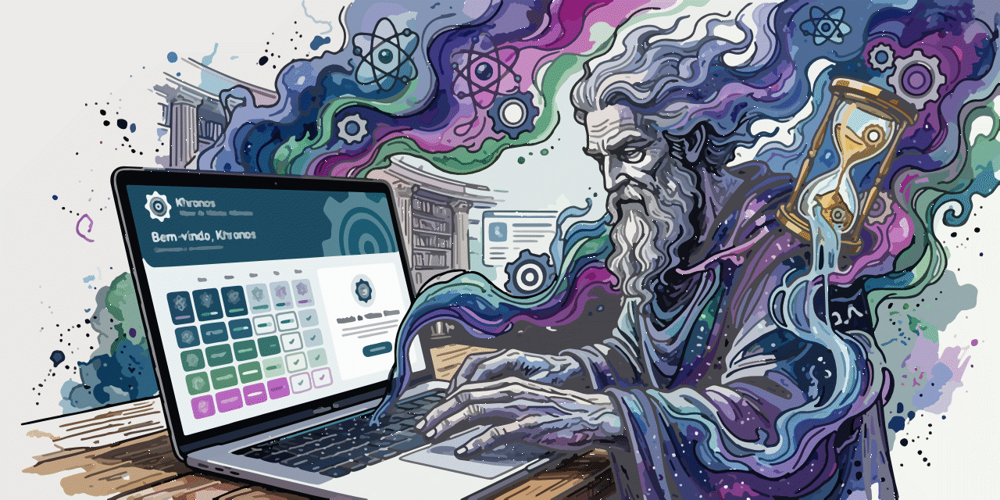

# KHRONOS — MOTOR DE HÁBITOS ATÔMICOS

## Manual completo do software — Versão 1.0

**Categoria:** produtividade, hábitos, acompanhamento temporal e gamificação.  
**Idioma:** português brasileiro.  
**Tecnologia:** HTML5, CSS3, JavaScript ES6+, Web App Manifest e Service Worker.  
**Modelo:** PWA offline-first, sem conta, sem servidor e sem sincronização.  
**Aplicativo:** https://magpe-stack.github.io/Khronos/  
**Código-fonte:** https://github.com/magpe-stack/Khronos  
**Ajuda:** https://github.com/magpe-stack/Khronos/blob/main/README.md

> **Escopo desta edição:** este manual descreve a implementação 1.0 fornecida no projeto. Algumas operações dependem do navegador, e a versão ainda requer testes de integração e acessibilidade antes de ser considerada validada para produção. O manual não substitui esses testes.

---

# PARTE I — IDENTIDADE, OBJETIVOS E CONCEITOS

## 1. Apresentação

O Khronos é um motor de hábitos atômicos que transforma tempo dedicado a projetos em uma unidade própria de progressão: **graus**. Seu propósito é ajudar o usuário a visualizar o acúmulo de esforço em atividades que exigem repetição, concentração e continuidade. Escrever, estudar, programar, desenhar, praticar um idioma ou organizar um projeto são exemplos de aplicações possíveis.

Em vez de apresentar apenas horas e minutos, o Khronos representa o esforço por meio de Pulsos, Giros, Turnos, Fases e Propulsões. O usuário pode iniciar e pausar sessões, registrar atividades realizadas fora do aplicativo, acompanhar o avanço contra chefões simbólicos e desbloquear conquistas conforme os graus se acumulam.

## Screenshots

### Khronos App



A interface do Khronos foi projetada com foco em usabilidade, desempenho e uma experiência visual limpa, facilitando o acompanhamento de tarefas e atividades em tempo real.

O aplicativo não avalia a qualidade do trabalho nem verifica automaticamente se uma tarefa foi realmente executada. Sua medida é o tempo declarado e contabilizado. A interpretação desse tempo como produtividade depende da honestidade do registro e dos critérios pessoais do usuário.

## 2. Por que o nome Khronos?

O nome faz referência a Khronos ou Chronos, figura associada à personificação do tempo na tradição mitológica e filosófica grega. Na identidade deste aplicativo, Khronos representa especialmente o tempo linear: a sequência contínua de instantes que não retorna ao ponto anterior.

A ideia central é o **efeito composto**. Uma pequena ação repetida muitas vezes pode produzir resultados relevantes. Dez minutos isolados parecem modestos; muitas sessões de dez minutos, realizadas ao longo de semanas, podem representar um investimento significativo. O efeito composto também pode operar negativamente: hábitos prejudiciais, repetidos por longos períodos, podem comprometer objetivos.

O Khronos não afirma que tempo investido produz necessariamente sucesso. O tempo é um recurso; qualidade da prática, descanso, planejamento, contexto e escolhas também importam. A metáfora do aplicativo é que o tempo multiplica aquilo que fazemos repetidamente.

## 3. Objetivos e público

O software foi concebido para pessoas que desejam acompanhar esforços de longo prazo em múltiplos projetos, especialmente quando os resultados não são imediatamente visíveis. Pode ser utilizado por escritores, estudantes, desenvolvedores, pesquisadores, artistas, profissionais independentes e qualquer pessoa que queira observar a continuidade de sua prática.

O Khronos é particularmente útil para acompanhar **tempo dedicado**, não para medir desempenho médico, produtividade empresarial certificada, frequência profissional legalmente auditável ou cumprimento de obrigações contratuais. Os dados podem ser alterados por entradas manuais e dependem do dispositivo local.

## 4. Princípios de operação

O funcionamento se apoia em cinco princípios. Primeiro, cada projeto mantém sua própria contagem acumulada. Segundo, o tempo pode ser registrado automaticamente ou por entrada manual. Terceiro, os graus são derivados do tempo, sem necessidade de conversão pelo usuário. Quarto, a progressão desbloqueia marcos simbólicos, sem atribuir valores morais ao usuário. Quinto, os dados permanecem sob controle local, sendo o backup responsabilidade de quem utiliza o aplicativo.

---

# PARTE II — UNIDADES E MATEMÁTICA DO TEMPO

## 5. O que é um grau?

No Khronos, **1 grau corresponde a 10 segundos**. Portanto, um minuto equivale a 6 graus, e uma hora equivale a 360 graus. A palavra “graus” representa uma unidade convencional de pontuação temporal criada para o sistema, não uma medida angular física do relógio ou de temperatura.

A fórmula básica é:

`graus = segundos / 10`

Para converter minutos:

`graus = minutos × 6`

Para converter graus em minutos:

`minutos = graus / 6`

O cronômetro armazena internamente milissegundos. Por isso, pode apresentar frações de grau durante uma sessão, embora as unidades maiores sejam contabilizadas apenas quando seus marcos inteiros são alcançados.

## 6. Hierarquia oficial

| Unidade | Equivalência | Graus | Minutos | Horas |
|---|---|---:|---:|---:|
| Pulso | 30 minutos | 180 | 30 | 0,5 |
| Giro | 2 Pulsos | 360 | 60 | 1 |
| Turno | 8 Giros | 2.880 | 480 | 8 |
| Fase | 30 Turnos | 86.400 | 14.400 | 240 |
| Propulsão | 42 Fases | 3.628.800 | 604.800 | 10.080 |

A Propulsão corresponde a 420 dias de 24 horas de tempo acumulado, ou a 1.260 Turnos de oito horas. Isso não significa que o usuário precise trabalhar continuamente: os graus são acumulados por sessões independentes ao longo do período que desejar.

## 7. Exemplos de conversão

Uma sessão de 15 minutos rende 90 graus. Trinta minutos rendem 180 graus e completam um Pulso. Uma hora rende 360 graus e completa um Giro. Duas horas rendem 720 graus, equivalentes a dois Giros. Oito horas acumuladas rendem 2.880 graus e completam um Turno.

Um projeto com 5.400 graus possui 900 minutos de trabalho, ou 15 horas. Esse total equivale a 30 Pulsos completos, 15 Giros completos e um Turno completo, com saldo de graus além do Turno. Os contadores exibidos não são categorias mutuamente exclusivas: a mesma duração pode ser expressa simultaneamente em Pulsos, Giros e Turnos.

## 8. Precisão e arredondamento

O sistema mantém o tempo em milissegundos e converte o resultado para graus. Na apresentação, a pontuação pode ser arredondada a duas casas decimais. O arredondamento visual não deve ser confundido com a perda do tempo original: o valor interno preserva uma precisão maior.

Se o relógio mostrar uma quantidade ligeiramente diferente entre duas atualizações, isso decorre da passagem natural do tempo. A atualização visual periódica não é a fonte da contagem; a contagem é recalculada a partir dos registros temporais. Essa distinção é importante para compreender por que uma aba suspensa pode voltar exibindo um total maior.

---

# PARTE III — REQUISITOS, ACESSO E INSTALAÇÃO

## 9. Requisitos mínimos

O Khronos requer um navegador moderno com JavaScript habilitado. Para a experiência PWA, são desejáveis suporte a Web App Manifest, Service Worker, Cache Storage e armazenamento local. O navegador deve permitir a gravação de dados do site e a execução de scripts. O acesso inicial pela internet é necessário para carregar os arquivos e preencher o cache offline.

A instalação como aplicativo depende das regras do navegador e do sistema operacional. Não existe instalador tradicional para Windows nem arquivo APK nesta versão. A interface pode ser utilizada diretamente no endereço web, mesmo quando o navegador não oferece a opção de instalação.

## 10. Acesso pelo navegador

Abra o endereço oficial:

https://magpe-stack.github.io/Khronos/

Na primeira visita, aguarde o carregamento da interface. O Service Worker será registrado quando o navegador permitir. Depois que os arquivos essenciais forem armazenados, o aplicativo poderá ser aberto sem conexão, desde que o cache e os dados locais continuem preservados.

Se o endereço exibir uma página 404, verifique se o repositório foi publicado corretamente, se existe um arquivo `index.html` na raiz e se a configuração do GitHub Pages aponta para a pasta e a ramificação adequadas. O nome do repositório e a capitalização das letras devem coincidir com o endereço publicado.

## 11. Instalação no Android

No Google Chrome para Android, abra o endereço oficial. Utilize o menu do navegador e procure uma opção como **Instalar aplicativo** ou **Adicionar à tela inicial**. A denominação e a disponibilidade variam conforme a versão do Chrome e os critérios de instalação. Confirme a operação quando a opção estiver disponível.

Depois da instalação, o Khronos poderá aparecer na tela inicial e abrir em uma janela com aparência de aplicativo. A instalação não cria automaticamente uma conta nem transfere projetos para outros dispositivos. Os dados continuam associados ao armazenamento do navegador ou do ambiente que hospeda o PWA.

## 12. Uso em desktop

No Chrome ou em outro navegador compatível, abra o endereço oficial. Se a instalação for oferecida, utilize o comando de instalação presente na interface do navegador. Também é possível continuar usando a versão web sem instalar nada.

O Khronos foi desenhado com abordagem mobile-first, mas sua grade de cartões se adapta a telas maiores. Em monitores desktop, a navegação permanece acessível pelo menu hambúrguer, enquanto o alternador de tema fica no canto superior direito.

## 13. Funcionamento offline

O modo offline depende de uma primeira visita bem-sucedida e da conclusão do armazenamento dos arquivos. O Service Worker usa um cache versionado para os recursos principais, como HTML, CSS, JavaScript, manifesto e ícones. Depois disso, a ausência de internet não impede necessariamente a abertura do aplicativo.

O cache não é uma garantia de preservação permanente. O navegador ou o sistema operacional podem remover dados por políticas de armazenamento, limpeza manual ou falta de espaço. Além disso, uma atualização de código exige que o navegador obtenha os novos arquivos em algum momento com conexão disponível.

---

# PARTE IV — INTERFACE E NAVEGAÇÃO

## 14. Tela de abertura

Ao iniciar, o Khronos apresenta uma tela de abertura com o símbolo da engrenagem, o nome do aplicativo e o subtítulo “Motor de Hábitos Atômicos”. A engrenagem executa uma rotação visual contínua. Na implementação 1.0, o temporizador de três segundos começa quando o JavaScript inicializa; portanto, a duração percebida desde o início do carregamento da página pode ser maior.

Pessoas que ativaram a preferência de movimento reduzido no sistema têm a animação limitada pelas regras CSS de acessibilidade. A tela de abertura é apenas uma apresentação visual e não representa uma verificação do armazenamento, uma sincronização ou um processo de login.

## 15. Cabeçalho

O cabeçalho reúne três elementos principais. À esquerda fica o botão do menu hambúrguer, que abre e fecha as opções de navegação e ação. Ao lado aparece a marca Khronos com a engrenagem. À direita, isolado dos demais comandos, está o botão de alternância entre os temas claro e escuro.

A marca é interativa: um clique retorna à página inicial. O botão de tema altera a aparência sem modificar os graus ou os registros. O tema claro é utilizado inicialmente; a preferência escolhida posteriormente é salva no navegador.

## 16. Menu hambúrguer

O menu concentra as principais ações: Início, Novo Projeto, Meus Projetos, Galeria de Conquistas, Histórico, Entrada Manual, Exportar Projeto JSON, Backup Geral, Importar ou Restaurar JSON, Imprimir Relatório, Sobre e Ajuda. O menu é fechado quando o usuário seleciona uma ação ou clica fora dele.

Essa organização preserva espaço na tela principal, especialmente em smartphones. Algumas ações exigem um projeto selecionado. Caso nenhum projeto esteja disponível, o aplicativo informa que é necessário criar ou selecionar um projeto antes de continuar.

## 17. Dashboard

A tela inicial mostra uma visão consolidada dos graus acumulados nos projetos. Também apresenta contadores de unidades completas e uma seleção de projetos recentes. O dashboard é uma visão geral, não um editor de registros.

A soma geral é calculada a partir dos tempos dos projetos existentes. Assim, o total global pode crescer quando há projetos com relógios em andamento. A implementação permite que diferentes projetos tenham registros temporais ativos simultaneamente; para evitar dupla contagem de tempo real, recomenda-se pausar um projeto antes de iniciar outro.

## 18. Tema claro e escuro

O modo claro utiliza superfícies claras, texto escuro e destaques derivados da paleta Itten. O modo escuro utiliza fundos azulados profundos e textos claros. A troca pode ser feita a qualquer momento pelo botão no topo direito.

Os estados não devem depender apenas de cores: o relógio exibe textos como “Contagem em andamento” e “Relógio pausado”, enquanto os botões apresentam rótulos próprios. Embora a interface tenha sido planejada para contraste e legibilidade, uma auditoria formal WCAG 2.1 ainda é necessária antes de afirmar conformidade integral AA ou AAA.

---

# PARTE V — GESTÃO DE PROJETOS

## 19. Criar um novo projeto

Abra o menu e selecione **Novo Projeto**. Uma caixa de diálogo solicitará o nome. Digite um título identificável, como “Romance de ficção científica”, “Estudo de programação” ou “Prática de inglês”, e confirme.

O projeto recebe um identificador interno, data de criação, pontuação inicial de zero graus e histórico vazio. Depois da criação, ele se torna o projeto selecionado e a interface abre sua tela de acompanhamento. O nome pode conter letras, números e espaços, respeitando o limite definido no formulário.

## 20. Meus Projetos

A seção **Meus Projetos** lista os projetos cadastrados, normalmente organizados do mais recente para o mais antigo. Cada cartão mostra o nome, os graus acumulados, o chefão atual, a Fase correspondente, o progresso do desafio e um comando para abrir o projeto.

O cartão também informa se existe uma contagem ativa ou se o relógio está pausado. Para acessar um projeto, utilize **Abrir projeto**. Isso altera o projeto selecionado, que passa a ser utilizado pelas ações de entrada manual, exportação individual, impressão e galeria.

## 21. Seleção e alternância

É possível manter vários projetos no armazenamento e alternar entre eles. A seleção de um projeto não encerra automaticamente o relógio de outro. Portanto, antes de trocar de atividade, entre no projeto atual e pressione **Pausar**. Em seguida, abra o projeto desejado e pressione **Continuar**.

Essa rotina evita que dois projetos acumulem graus pelo mesmo período de relógio. Se o usuário desejar contabilizar atividades simultâneas, deve compreender que o total global será a soma dos tempos registrados, e não necessariamente a duração cronológica exclusiva.

## 22. Recursos ainda não presentes

Na implementação documentada, não existem comandos específicos de renomear, excluir, arquivar ou duplicar projetos. Também não há pastas, etiquetas, prioridades, metas personalizadas, compartilhamento colaborativo ou sincronização entre aparelhos.

Não procure esses comandos em menus ocultos: eles não fazem parte desta versão. Caso precise reorganizar os nomes, isso deverá ser tratado em uma atualização futura. Não é recomendado editar manualmente o conteúdo do armazenamento local, pois uma alteração incorreta pode comprometer a leitura dos dados.

---

# PARTE VI — CRONÔMETRO E REGISTRO DE ATIVIDADES

## 23. Iniciar a contagem

Abra um projeto e localize o painel **Relógio de Graus**. Quando estiver pausado, o botão apresentará **Continuar**. Pressione-o no momento em que começar a atividade. O sistema registra o horário inicial e passa a calcular o tempo transcorrido.

O relógio apresenta horas, minutos e segundos. Logo abaixo, a pontuação correspondente aparece em graus. A contagem não depende de um evento por segundo para permanecer matematicamente correta: a interface é atualizada periodicamente, mas o total é derivado da diferença entre horários.

## 24. Pausar a contagem

Quando interromper o trabalho, pressione **Pausar**. O aplicativo encerra o intervalo atual, adiciona a duração ao acumulado do projeto e cria um registro no histórico. O botão volta a mostrar **Continuar**.

Use a pausa em intervalos que não deseja contabilizar, como refeições, descanso, telefonemas pessoais ou outras atividades fora do escopo do projeto. O Khronos não decide automaticamente quais pausas são apropriadas: o critério é do usuário.

## 25. Retomar a contagem

Depois de uma pausa, pressione **Continuar**. A pontuação acumulada é preservada, e um novo intervalo começa a ser contabilizado. Ao pausar novamente, esse novo intervalo é adicionado ao histórico.

Por exemplo, um projeto pode acumular 20 minutos pela manhã, 40 minutos à tarde e 30 minutos à noite. Ao final, terá 90 minutos, equivalentes a 540 graus. A continuidade do projeto não exige que todo o tempo seja registrado em uma única sessão.

## 26. Aba em segundo plano e tela bloqueada

O navegador pode suspender temporizadores e atualizações visuais quando a aba está em segundo plano ou quando o telefone é bloqueado. A implementação do Khronos utiliza horários absolutos para calcular o intervalo transcorrido. Assim, ao retornar à página, a contagem pode refletir o período em que a interface não foi atualizada.

Isso não garante execução permanente do JavaScript em segundo plano. Também não comprova trabalho ininterrupto. Se o navegador encerrar o processo, o aplicativo dependerá dos dados previamente salvos para reconstruir a sessão. A mudança manual do relógio do dispositivo pode afetar a duração calculada.

## 27. Entrada manual

Para adicionar tempo realizado fora da estação de trabalho, selecione o projeto, abra o menu e escolha **Entrada Manual**. Escolha a unidade **Minutos** ou **Graus**, informe uma quantidade positiva e, se desejar, escreva uma observação curta.

O sistema converte a quantidade para milissegundos e adiciona o resultado ao total do projeto. Um registro separado é criado com o tipo “Entrada manual”, a data e a observação. Essa identificação permite distinguir atividades declaradas das sessões cronometradas.

## 28. Exemplos de entrada manual

Se você estudou durante 45 minutos sem o aplicativo, escolha minutos e informe 45. O projeto receberá 270 graus. Se deseja registrar exatamente um Pulso, escolha graus e informe 180. O resultado será equivalente a 30 minutos.

Não informe graus no campo de minutos ou minutos no campo de graus, pois o resultado será diferente. Verifique a unidade antes de confirmar. A versão 1.0 não oferece um comando próprio para desfazer ou editar um registro manual após a gravação.

## 29. Histórico de atividades

O histórico reúne os intervalos finalizados e as entradas manuais. Cada registro apresenta a origem do tempo, sua quantidade, o horário e uma observação quando disponível. A tela geral de histórico agrega registros dos diferentes projetos, ordenados pelos horários informados.

Uma sessão ainda em andamento não aparece como registro finalizado até ser pausada. O total do relógio, entretanto, já pode incluir seu tempo em curso. Essa diferença entre **tempo acumulado** e **sessões finalizadas** é esperada.

---

# PARTE VII — CHEFÕES, FASES E CONQUISTAS

## 30. O sistema de chefões

Os chefões são personagens simbólicos que representam obstáculos comuns à continuidade dos hábitos. O objetivo não é diagnosticar dificuldades pessoais, mas oferecer uma narrativa de progressão. Ao acumular graus, o projeto avança em direção à derrota do chefão atual.

Na versão 1.0, cada chefão exige o equivalente a uma Fase completa: **86.400 graus**. O progresso é calculado automaticamente, e o próximo chefão é selecionado quando o projeto ultrapassa o marco. O número de chefões derrotados corresponde à quantidade de Fases completas acumuladas.

## 31. Chefões temáticos

Os cinco primeiros chefões são **Procrastinação**, **Preguiça**, **Distração Digital**, **Cansaço Mental** e **Paralisia por Análise**. Outros personagens da sequência incluem Desorganização, Impaciência, Inconstância, Autossabotagem e Desistência.

Após a sequência definida, os nomes voltam a ser utilizados ciclicamente em Fases posteriores. A dificuldade temporal é constante na implementação atual: cada Fase demanda a mesma quantidade de graus. Não existe combate por comandos, sistema de dano variável ou inteligência artificial dos chefões.

## 32. Barra de progresso

A barra indica a porcentagem do intervalo de 86.400 graus já percorrido na Fase atual. Um projeto com 43.200 graus, por exemplo, estará na metade da primeira Fase. Ao atingir 86.400 graus, completa o desafio e passa à Fase seguinte.

A barra não mede a qualidade da execução, a dificuldade subjetiva da tarefa ou o estado psicológico do usuário. Ela representa exclusivamente a relação matemática entre os graus acumulados e o marco temporal da Fase.

## 33. Galeria de Conquistas

A galeria exibe medalhas desbloqueadas e conquistas ainda bloqueadas. Cada conquista possui nome, marco em graus, raridade e representação visual. O desbloqueio é automático quando o projeto selecionado atinge o valor exigido.

A galeria é associada ao projeto selecionado. Portanto, conquistas obtidas em um projeto não são automaticamente transferidas para outro. O dashboard pode somar todos os graus, mas as recompensas individuais são calculadas a partir do histórico de cada projeto.

## 34. Marcos de medalhas

| Conquista | Marco | Raridade |
|---|---:|---|
| Primeiro Movimento | 1 grau | Bronze |
| Primeiro Pulso | 180 graus | Bronze |
| Primeiro Giro | 360 graus | Prata |
| Cinco Giros | 1.800 graus | Prata |
| Primeiro Turno | 2.880 graus | Ouro |
| Dez Turnos | 28.800 graus | Ouro |
| Primeira Fase | 86.400 graus | Platina |
| Cinco Fases | 432.000 graus | Platina |
| Dez Fases | 864.000 graus | Diamante |
| Vinte Fases | 1.728.000 graus | Diamante |
| Primeira Propulsão | 3.628.800 graus | Lendário |
| Duas Propulsões | 7.257.600 graus | Lendário |
| Cinco Propulsões | 18.144.000 graus | Mítico |

Os nomes e raridades são regras fixas da versão atual. Não há editor de conquistas personalizadas. Uma medalha desbloqueada é mostrada na galeria enquanto o projeto mantém graus suficientes para aquele marco.

## 35. Diplomas honoríficos

O Khronos apresenta diplomas honoríficos para conquistas desbloqueadas a partir de 2.880 graus. Cada diploma identifica o projeto, o marco atingido e a distinção de raridade. Os diplomas são gerados dinamicamente a partir da pontuação; não são certificados emitidos por instituição externa.

A seção de impressão inclui os diplomas elegíveis no relatório do projeto. O documento tem valor motivacional e pessoal, não equivalendo a certificado acadêmico, profissional, de carga horária auditada ou de participação institucional.

---

# PARTE VIII — EXPORTAÇÃO, BACKUP E RESTAURAÇÃO

## 36. Por que fazer backup?

O Khronos guarda informações no armazenamento local do navegador. Esse modelo evita a necessidade de servidor, mas também significa que os dados não são recuperados automaticamente caso o dispositivo seja perdido, formatado ou tenha seus dados de navegação apagados.

O backup é a principal medida de proteção. Recomenda-se gerar cópias antes de atualizações importantes, depois de períodos significativos de trabalho e antes de limpar o navegador. Guarde ao menos uma cópia fora do dispositivo utilizado para registrar as sessões.

## 37. Backup Geral

Abra o menu e escolha **Backup Geral**. O aplicativo prepara um arquivo JSON com todos os projetos e seus registros, além de informações de configuração exportáveis. O download é iniciado pelo navegador.

A nomenclatura segue o padrão:

`backup-khronos-AAAA-MM-DD-HH-MM.json`

Exemplo: `backup-khronos-2026-11-06-21-30.json`.

O horário do nome é obtido do relógio local do dispositivo. Dois backups gerados no mesmo minuto podem receber o mesmo nome, e o navegador decidirá como tratar downloads com nomes repetidos.

## 38. Exportação individual

Selecione o projeto desejado e escolha **Exportar Projeto JSON** no menu. O arquivo conterá o projeto selecionado, com sua pontuação e seus registros. O nome seguirá o padrão:

`export-khronos-AAAA-MM-DD-HH-MM.json`

A exportação individual é útil para transportar ou preservar um projeto sem incluir os demais. Ela não apaga nem altera o projeto original. Um projeto exportado pode ser importado posteriormente como cópia independente.

## 39. Sessões ativas durante exportação

Quando um relógio está em andamento, a exportação calcula o intervalo transcorrido até o momento da geração do arquivo. O arquivo exportado representa uma fotografia temporal daquele instante e não mantém a sessão em execução.

No aplicativo original, a sessão pode continuar ativa depois do download. Portanto, o total do projeto original poderá superar o total do arquivo exportado. Para obter um marco de encerramento claro, pause o relógio antes de exportar.

## 40. Importar projeto

Abra o menu e selecione **Importar / Restaurar JSON**. Escolha um arquivo de exportação individual compatível. O Khronos lê o JSON, valida sua estrutura básica e adiciona uma nova cópia do projeto ao conjunto existente.

A cópia importada recebe um novo identificador e tem seu nome complementado com a indicação “(importado)”. Esse comportamento evita conflito direto de identificadores com o projeto original. A importação não exclui os projetos já presentes.

## 41. Restaurar Backup Geral

Selecione o arquivo de backup global. O aplicativo exibirá uma confirmação porque a restauração **substitui o conjunto atual de projetos** pelo conjunto contido no arquivo. Antes de confirmar, gere um backup atualizado dos dados existentes, se eles forem importantes.

Depois da restauração, os projetos presentes no arquivo passam a compor a base local. Os projetos que existiam apenas no armazenamento anterior deixam de aparecer. A operação não faz mesclagem automática entre backups globais diferentes.

## 42. Validação dos arquivos

A importação aceita JSON com a estrutura esperada pela versão 1.0. O aplicativo verifica a versão, a presença dos projetos, campos essenciais, tipos básicos e registros reconhecidos. Também impõe um limite de tamanho de arquivo na leitura.

Essa validação reduz erros comuns, mas não constitui auditoria criptográfica nem garantia contra arquivos maliciosamente construídos. Importe somente arquivos de origem confiável. A versão atual não utiliza assinatura digital, senha, criptografia ou verificação por hash dos backups.

## 43. Proteção e privacidade dos backups

Arquivos JSON são documentos de texto estruturado. Eles podem conter nomes de projetos, observações, horários e durações. Qualquer pessoa com acesso ao arquivo pode potencialmente ler essas informações.

Se os dados forem privados, guarde os backups em local protegido. Não publique um backup pessoal em repositório público e não envie o arquivo para terceiros sem verificar seu conteúdo. A ausência de servidor no Khronos não impede exposição de dados quando o usuário compartilha voluntariamente o arquivo.

---

# PARTE IX — RELATÓRIOS E IMPRESSÃO

## 44. Gerar relatório

Abra o projeto que deseja documentar. No menu hambúrguer, selecione **Imprimir Relatório**. O Khronos abre uma nova janela com o relatório formatado e solicita a impressão pelo mecanismo nativo do navegador.

O relatório contém identificação do projeto, data de geração, data de criação, pontuação em graus, duração, equivalências temporais, chefão atual, conquistas desbloqueadas, diplomas elegíveis e histórico de registros.

## 45. Salvar como PDF

Se o navegador ou sistema operacional disponibilizar a opção **Salvar como PDF** na caixa de impressão, ela poderá ser utilizada para gerar um documento eletrônico. Essa função é oferecida pelo navegador, não por uma biblioteca de PDF incorporada ao Khronos.

Antes de salvar, confira a visualização de impressão, o tamanho do papel, as margens e a orientação. Em projetos com histórico extenso, o relatório poderá ocupar muitas páginas. O aplicativo não possui nesta versão um editor avançado de layout de impressão.

## 46. Problemas com janelas pop-up

A impressão utiliza a abertura de uma nova janela. Se o navegador bloquear pop-ups, o relatório pode não aparecer. Verifique o indicador de bloqueio na barra de endereços e permita a abertura para o site, caso confie nele.

Em alguns ambientes, a impressão pode ser aberta de forma diferente ou exigir uma segunda ação do usuário. Se o relatório não surgir, tente novamente em uma aba normal do Chrome, com bloqueadores temporariamente ajustados para o endereço do aplicativo.

---

# PARTE X — ARMAZENAMENTO, SEGURANÇA E CONFIABILIDADE

## 47. Onde ficam os dados?

A versão 1.0 utiliza `localStorage` para persistir o estado principal. Os dados são associados à origem do site no navegador. Eles não são enviados automaticamente ao GitHub, a um servidor do desenvolvedor ou a uma conta online.

O Service Worker e o Cache Storage guardam arquivos da aplicação para permitir uso offline. Esses caches são diferentes do armazenamento de projetos. Apagar apenas um cache de recursos não equivale necessariamente a apagar os projetos; entretanto, a opção de limpar todos os dados do site pode remover ambos.

## 48. Limites do armazenamento local

O `localStorage` tem capacidade limitada, que varia entre navegadores e ambientes. O Khronos salva o estado em formato JSON, incluindo os registros históricos. Com grande quantidade de projetos ou sessões, o espaço ocupado cresce.

Se o navegador recusar uma gravação, o aplicativo apresenta uma mensagem de erro. Isso significa que o registro pode não ter sido persistido. Para projetos muito longos, é prudente exportar backups regularmente e verificar se os novos registros permanecem após recarregar a página.

## 49. O que acontece se o navegador fechar?

O estado do cronômetro é salvo quando uma sessão começa e em outros momentos definidos pelo aplicativo. Se o navegador encerrar a aba, a recuperação dependerá do último estado efetivamente gravado. Ao reabrir, uma sessão ainda marcada como ativa poderá continuar refletindo o tempo decorrido.

Esse comportamento deve ser interpretado com cuidado: se você deixou uma sessão ativa por engano, o aplicativo não saberá distinguir o período trabalhado do período de ausência. Também existem riscos de perda de alterações recentes se o processo for encerrado abruptamente ou se uma gravação falhar.

## 50. Alteração do relógio do dispositivo

O cálculo utiliza horários fornecidos pelo sistema. Mudanças manuais de data ou hora podem causar diferenças na duração computada. O aplicativo não utiliza uma fonte externa de tempo certificada nem dispõe de um relógio independente resistente a manipulações.

Para reduzir inconsistências, mantenha a configuração automática de data e hora do dispositivo ativada. Evite alterar o horário durante sessões em andamento. Se perceber valores inesperados, pause o cronômetro, verifique o relógio do aparelho e preserve um backup antes de realizar novas operações.

## 51. Privacidade

Não há cadastro de usuário, autenticação, rastreamento remoto implementado ou transmissão automática dos projetos para um servidor próprio. Isso reduz a quantidade de dados compartilhados durante a operação normal.

Por outro lado, pessoas com acesso ao mesmo perfil de navegador ou ao dispositivo desbloqueado podem visualizar os projetos. A proteção do aparelho, o bloqueio de tela e os cuidados com arquivos exportados continuam importantes. O Khronos não fornece bloqueio por senha próprio.

## 52. Integridade dos registros

A versão atual não possui trilha de auditoria imutável, assinaturas criptográficas, proteção contra alteração do armazenamento ou mecanismo de detecção de adulteração. Entradas manuais modificam legitimamente a pontuação. Por isso, não use os relatórios como prova independente de horas efetivamente trabalhadas.

O histórico é um recurso de acompanhamento pessoal. Em contextos que exigem comprovação formal, utilize sistemas específicos com autenticação, controles de acesso e auditoria adequada.

---

# PARTE XI — ACESSIBILIDADE E EXPERIÊNCIA DE USO

## 53. Design mobile-first

O Khronos foi desenhado para telas pequenas, com botões de toque, cartões responsivos e navegação concentrada no menu. Em telas maiores, os cartões são organizados em mais colunas. A interface procura manter os comandos principais reconhecíveis sem depender de gestos complexos.

No smartphone, utilize preferencialmente a orientação em que os textos e botões fiquem confortáveis. O layout se adapta à largura disponível, mas o comportamento final deve ser verificado em aparelhos reais e com diferentes configurações de tamanho de fonte.

## 54. Paleta cromática Itten

A identidade visual emprega os tokens de cores fornecidos para o projeto, incluindo os tons de azul, azul-esverdeado, violeta e verde. As cores de base são `#273877`, `#64A076` e `#C960D7`. Os demais tokens são organizados como variáveis CSS, facilitando manutenção e consistência.

A paleta visual não deve ser confundida com certificação de contraste. Para validar conformidade WCAG 2.1 AA ou AAA, é necessário medir as combinações reais de texto e fundo, estados de foco, bordas, elementos desabilitados e componentes nos dois temas.

## 55. Navegação por teclado

Botões, links e campos utilizam elementos HTML nativos, permitindo navegação por teclado nos navegadores compatíveis. O foco visível recebe destaque CSS. As caixas de diálogo utilizam o elemento `dialog`, que oferece comportamento nativo de abertura modal.

Para navegar, utilize Tab e Shift+Tab. Pressione Enter ou Espaço para ativar controles apropriados. A tecla Escape pode fechar o menu e, conforme o comportamento nativo do navegador, a caixa de diálogo. A acessibilidade completa com leitores de tela ainda requer testes específicos.

## 56. Movimento reduzido

O CSS considera a preferência do sistema por movimento reduzido. Quando ativada, as animações e transições são praticamente eliminadas. Isso inclui a rotação visual da engrenagem na abertura.

A redução de movimento não altera a pontuação, a duração das sessões ou as regras de conquista. Ela afeta apenas a apresentação visual. O usuário pode modificar essa preferência nas configurações de acessibilidade do próprio dispositivo.

---

# PARTE XII — SOLUÇÃO DE PROBLEMAS

## 57. O site mostra erro 404

Confirme o endereço oficial, o nome do repositório e a presença de `index.html` na raiz. Verifique se o GitHub Pages foi ativado para a ramificação correta e se a publicação terminou. Arquivos com letras maiúsculas e minúsculas diferentes podem gerar erros de caminho.

Se o site foi publicado recentemente, aguarde a conclusão do processo e atualize a página. Consulte também a área de implantação do repositório para identificar falhas de publicação.

## 58. A página abre sem estilos

Verifique se `styles.css` está na raiz e se o nome coincide exatamente com a referência do HTML. Abra as ferramentas de desenvolvedor do Chrome e consulte a aba Network para identificar requisições com erro.

Uma versão antiga do Service Worker também pode estar entregando arquivos desatualizados. Atualize a versão do cache quando publicar mudanças e recarregue o aplicativo após a instalação do novo Service Worker.

## 59. Botões não funcionam

Confira se `app.js` foi carregado sem erros. Abra o Console do navegador e procure mensagens relacionadas a JavaScript. Certifique-se de que o arquivo não foi truncado durante a cópia para o repositório.

O Khronos depende de JavaScript para navegar, salvar projetos, controlar o relógio e gerar exportações. Com scripts bloqueados ou erros de sintaxe, essas funções não estarão disponíveis.

## 60. O ícone não aparece

Confirme que os arquivos `icon-192.png` e `icon-512.png` existem na raiz e são PNGs válidos com dimensões correspondentes. Verifique se o manifesto referencia os caminhos corretos e se os arquivos abrem diretamente pelo navegador.

Ícones instalados podem permanecer em cache por algum tempo. Uma atualização de imagem nem sempre aparece imediatamente no atalho existente. Dependendo do sistema, pode ser necessário atualizar a instalação ou recriar o atalho.

## 61. A instalação PWA não é oferecida

Verifique o acesso por HTTPS, a validade do manifesto, os ícones e o registro do Service Worker. Confirme que o navegador e a plataforma oferecem instalação para aquela configuração.

A ausência de um botão de instalação não significa necessariamente que a página esteja inutilizável. O Khronos pode continuar funcionando como aplicativo web. A interface 1.0 não possui um botão próprio que capture o evento de instalação do navegador.

## 62. Os graus parecem incorretos

Primeiro, confirme a equivalência: seis graus por minuto. Em seguida, verifique se a sessão ficou ativa enquanto o usuário estava ausente, se há mais de um projeto com relógio em andamento ou se foram adicionadas entradas manuais.

Confira também a data e a hora do aparelho. Se a divergência persistir, preserve um backup, anote a sequência de ações e teste com um projeto novo. Não apague os dados antes de salvar o que for recuperável.

## 63. Os dados desapareceram

Verifique se está utilizando o mesmo navegador, perfil e origem do site. Dados de uma aba anônima, de outro navegador ou de outro dispositivo não são automaticamente compartilhados. Confira se houve limpeza de dados de navegação.

Se possuir um backup, utilize **Importar / Restaurar JSON**. Lembre-se de que restaurar um backup global substitui o conjunto atual. Caso não exista backup e o armazenamento local tenha sido apagado, a versão 1.0 não oferece recuperação remota.

## 64. O backup não baixa

Verifique as permissões de download do navegador, o espaço disponível e a pasta de downloads. Confira se há bloqueios de segurança ou configurações que exigem confirmação para salvar arquivos.

Tente gerar o backup novamente e observe se aparece uma notificação do navegador. Se o arquivo for salvo, abra-o apenas para confirmar que contém JSON legível; não altere seu conteúdo sem necessidade.

## 65. A importação falha

Confirme que selecionou um arquivo `.json` compatível com o Khronos 1.0. Arquivos de outros aplicativos não possuem necessariamente a mesma estrutura. Verifique se o download foi concluído e se o arquivo não está vazio ou corrompido.

Uma mensagem de incompatibilidade também pode ocorrer quando os campos esperados estão ausentes ou foram alterados manualmente. Se possível, teste outra cópia do backup original. Não tente resolver problemas de importação removendo aleatoriamente campos do JSON.

## 66. O aplicativo não funciona offline

Abra o site com conexão e permita que os arquivos sejam carregados integralmente. Depois, teste novamente sem internet. Se o cache estiver incompleto ou tiver sido removido, a abertura offline poderá falhar.

O uso offline depende das políticas do navegador e da disponibilidade dos recursos armazenados. Para testar, utilize as ferramentas de desenvolvedor ou o modo avião após uma visita online bem-sucedida.

---

# PARTE XIII — MANUTENÇÃO TÉCNICA

## 67. Estrutura de arquivos

A distribuição básica contém:

```text
Khronos/
├── index.html
├── styles.css
├── app.js
├── manifest.json
├── sw.js
├── icon-192.png
├── icon-512.png
└── README.md
```

O `index.html` define a estrutura e os elementos da interface. O `styles.css` reúne temas, responsividade e apresentação. O `app.js` implementa dados, navegação, contagem, projetos e exportações. O `manifest.json` fornece metadados de instalação. O `sw.js` gerencia o cache offline. Os PNGs são os ícones do aplicativo.

## 68. Atualização do Service Worker

Ao publicar uma atualização que modifique os arquivos estáticos, altere o identificador de cache no `sw.js`, por exemplo, de `khronos-static-v1` para `khronos-static-v2`. Isso permite que o novo Service Worker utilize um cache diferente e remova versões antigas durante sua ativação.

A atualização não é necessariamente instantânea em todas as abas. Teste o carregamento após fechar e reabrir o aplicativo. Evite modificar a estrutura dos dados persistidos sem planejar migração, pois backups antigos podem se tornar incompatíveis com versões futuras.

## 69. Testes recomendados

Antes de publicar uma versão definitiva, execute testes de criação de projetos, pausa, retomada, alternância entre projetos, sessões com tela bloqueada, entradas manuais, marcos de conquistas, passagem de Fase, exportação, importação, restauração, impressão e uso offline.

Inclua testes de falha: armazenamento cheio, JSON inválido, interrupção do navegador, relógio do dispositivo alterado, arquivo de backup grande, múltiplas sessões ativas e atualizações com cache antigo. A implementação 1.0 ainda não foi certificada por uma suíte automatizada completa.

## 70. Limitações conhecidas da versão 1.0

O aplicativo não possui exclusão, renomeação ou edição de projetos; não permite corrigir registros individuais; não oferece autenticação ou sincronização; não tem metas personalizadas nem notificações; não comprova trabalho efetivo; e não impede sessões simultâneas em projetos diferentes.

Além disso, a visualização do chefão pode exigir uma nova renderização após a passagem de Fase durante uma sessão ativa. O armazenamento local pode atingir limites. A importação exige validações adicionais para cenários adversariais, e a interface ainda precisa de auditoria formal de acessibilidade. Essas limitações devem orientar futuras atualizações.

## 71. Boas práticas de utilização

Comece com poucos projetos e nomes claros. Pause o relógio sempre que deixar de trabalhar. Utilize entradas manuais apenas para períodos que realmente deseja registrar. Consulte a galeria como instrumento de motivação, não como medida absoluta de mérito.

Faça backups regulares, especialmente após grandes avanços. Mantenha o dispositivo atualizado e protegido. Antes de restaurar um backup, preserve os dados atuais. Ao comparar períodos, considere não apenas os graus acumulados, mas também a qualidade do trabalho, o descanso e os resultados concretos.

---

# PARTE XIV — GLOSSÁRIO E REFERÊNCIAS

## 72. Glossário

**Grau:** unidade temporal básica do Khronos, equivalente a dez segundos. **Pulso:** 180 graus ou trinta minutos. **Giro:** 360 graus ou uma hora. **Turno:** 2.880 graus ou oito horas. **Fase:** 86.400 graus ou trinta Turnos. **Propulsão:** 3.628.800 graus ou quarenta e duas Fases.

**Chefão:** desafio simbólico associado a uma Fase. **Conquista:** marco desbloqueado por graus acumulados. **Diploma:** representação honorífica gerada pelo aplicativo. **Sessão:** intervalo de cronômetro encerrado pela pausa. **Entrada manual:** tempo declarado pelo usuário. **Dashboard:** painel de visão geral. **PWA:** aplicação web que pode oferecer instalação e recursos offline. **Service Worker:** script do navegador que gerencia determinados eventos e recursos em cache. **JSON:** formato textual estruturado utilizado nos arquivos de exportação.

## 73. Endereços oficiais

**Aplicativo:** https://magpe-stack.github.io/Khronos/  
**Repositório:** https://github.com/magpe-stack/Khronos  
**Manual:** https://github.com/magpe-stack/Khronos/blob/main/README.md

Estes são os endereços previstos para a distribuição oficial. Sua disponibilidade depende da publicação e manutenção do repositório correspondente.

## 74. Considerações finais

O Khronos foi criado para tornar visível uma dimensão frequentemente negligenciada dos projetos: a acumulação de pequenos períodos de dedicação. Seu sistema de graus oferece uma linguagem alternativa para observar essa continuidade, enquanto os chefões e as conquistas introduzem elementos lúdicos no acompanhamento do tempo.

Nenhuma pontuação substitui o discernimento sobre o que merece ser feito. Um projeto pode acumular muitos graus e ainda precisar de mudanças de método. Outro pode avançar significativamente com poucas horas de trabalho bem orientado. O aplicativo deve ser utilizado como apoio à consciência temporal, não como fonte de pressão constante.

**Khronos — O tempo multiplica seus hábitos.**

---

*Fim do Manual Completo do Software — Khronos 1.0.*
